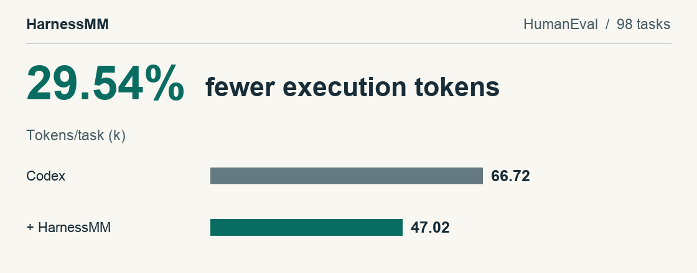
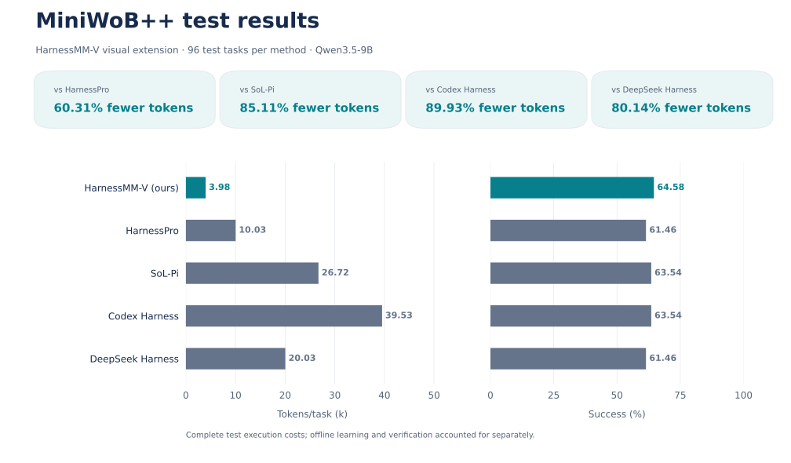
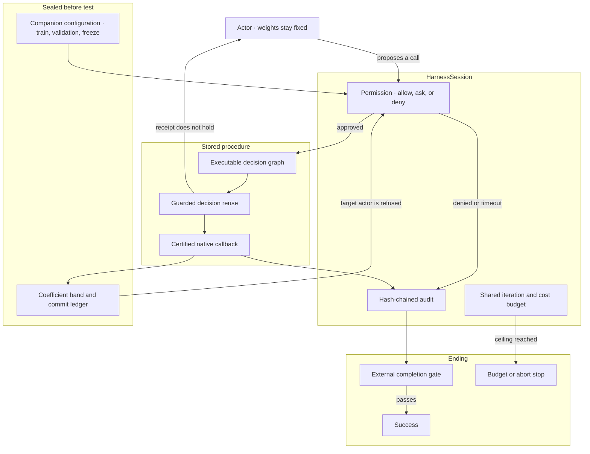
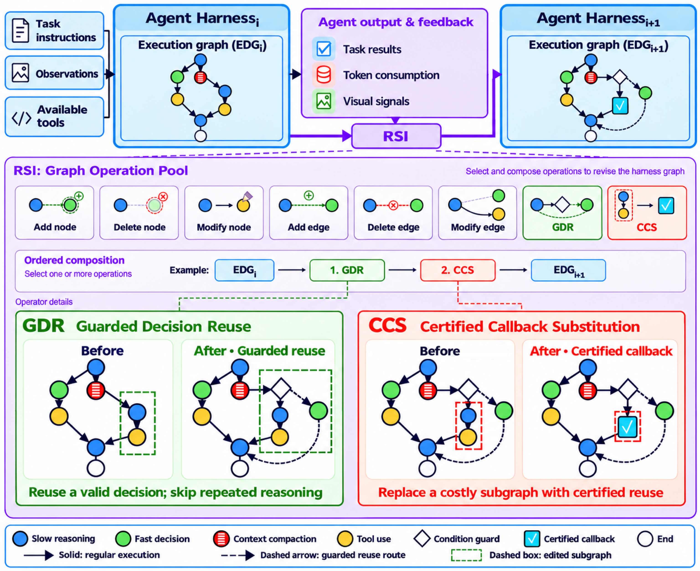
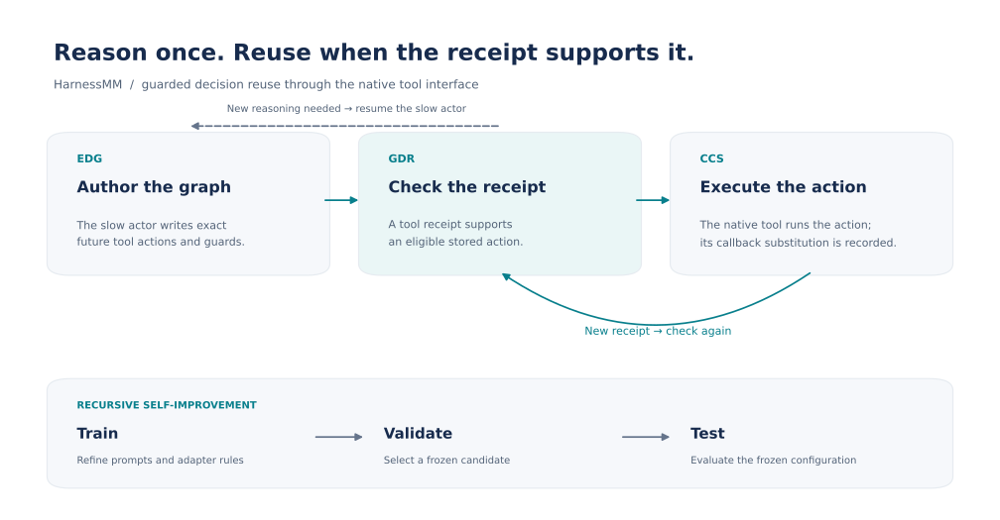
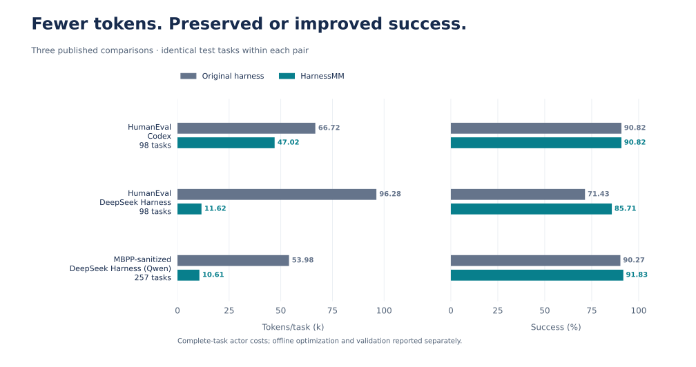
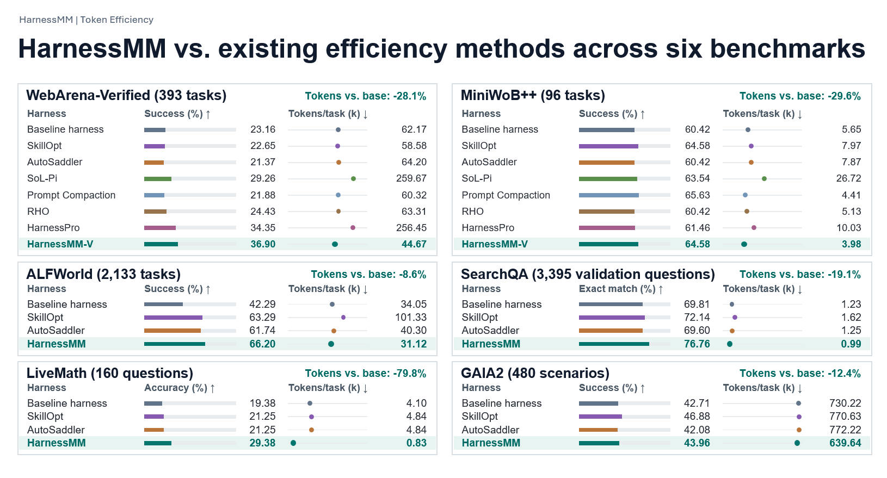
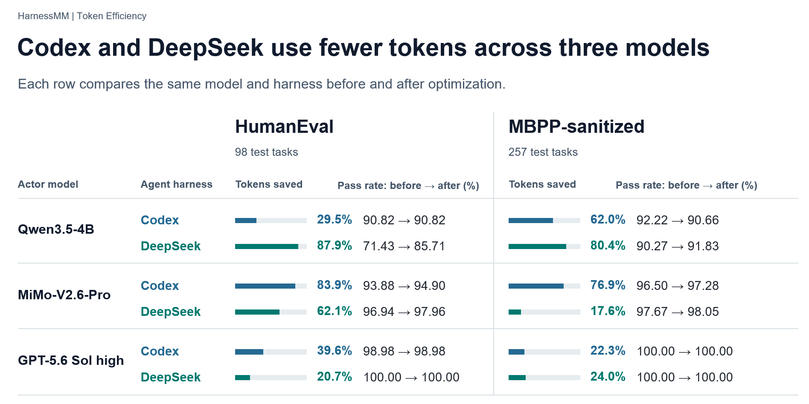

# Adaptive Improving Harness

**The procedure improves. The actor's weights stay fixed.**

<p align="center">
  <picture>
    <source media="(prefers-reduced-motion: reduce)" srcset="docs/assets/readme/guarded-reuse.png">
    
  </picture>
</p>

[Run the guarded-reuse example](examples/guarded_reuse.mjs) · [See the coding results](#codex-and-deepseek-coding-harnesses) · [Reuse a weight program](examples/weight_space_reuse.py) · [Try the pi extension](pi-extension/)

This repository is the adaptive improving harness for the MIT weight-space programming program. Weight-space programming writes a target network by hand. The neighboring weight editor is [AgenticWeightInfra](https://github.com/akramIOT/AgenticWeightInfra). This harness changes the procedure that calls tools: it stores decisions, checks receipts, substitutes native callbacks, and freezes companion configuration before test. The actor's weights are not an optimization variable.

The measured results below are from that procedure, published as HarnessMM and the November 20, 2026 HarnessMM-V manuscript. The Python package in this checkout is `adaptive_harness`.

An agent plans several tool calls in one model turn. After each call, the harness reads the tool result and runs the next planned action when its conditions hold. On HumanEval, Codex with this procedure used 29.54% fewer execution tokens at the same 90.82% success rate.

HarnessMM-V extends the same approach to visual tasks. On 96 MiniWoB++ test tasks, it solved 62 tasks at 3.98 Tokens/task (k), a 29.56% reduction in test execution tokens compared with the baseline harness.

[Robotics](robotics/) holds the HarnessMM-R MuJoCo demonstrations. For tabletop sorting, run the offline expert on a CPU or let Qwen3.8-27B plan pick-and-place actions on an H200. The [ARX X5 generator and four-view demo](robotics/#arx-x5-pcb-assembly) cover dual-arm PCB assembly.

A weight-space goal uses the same rule. `WeightEditSession` reuses a stored program when the target signature matches and the probe receipt still holds. `CoefficientBand` seals the coefficient window before test. Inject stays inside 4–20 and steer stays inside 0.4–1.4. Run [`examples/weight_space_reuse.py`](examples/weight_space_reuse.py). That example uses synthetic receipts and is separate from the benchmark tables below. See [how this checkout is organized](docs/ADAPTIVE_HARNESS.md).

## HarnessPro, SoL-Pi, Codex and DeepSeek comparisons



| Method | Success (%) | Tokens/task (k) | HarnessMM-V token saving (%) |
| --- | ---: | ---: | ---: |
| **HarnessMM-V (ours)** | **64.58** | **3.98** | — |
| baseline harness | 60.42 | 5.65 | **29.56** |
| HarnessPro | 61.46 | 10.03 | **60.31** |
| SoL-Pi | 63.54 | 26.72 | **85.11** |
| Codex Harness | 63.54 | 39.53 | **89.93** |
| DeepSeek Harness | 61.46 | 20.03 | **80.14** |

The same 96-task test, with every method in the November 20, 2026 comparison:

| Method | Successes / tasks | Success (%) | Tokens/task (k) |
| --- | ---: | ---: | ---: |
| baseline harness | 58 / 96 | 60.42 | 5.65 |
| SkillOpt | 62 / 96 | 64.58 | 7.97 |
| AutoSaddler | 58 / 96 | 60.42 | 7.87 |
| SoL-Pi | 61 / 96 | 63.54 | 26.72 |
| Prompt Compaction | 63 / 96 | 65.63 | 4.41 |
| DeepSeek Harness | 59 / 96 | 61.46 | 20.03 |
| Codex Harness | 61 / 96 | 63.54 | 39.53 |
| RHO | 58 / 96 | 60.42 | 5.13 |
| HarnessPro | 59 / 96 | 61.46 | 10.03 |
| HarnessMM-V | 62 / 96 | 64.58 | 3.98 |

The same integer execution totals give a HarnessMM-V saving against every arm. Savings already printed above stay 29.56, 60.31, 85.11, 89.93, and 80.14. The four arms that were not in that saving column are SkillOpt 50.08, AutoSaddler 49.43, Prompt Compaction 9.80, and RHO 22.39. `python reproduction/empirical_counts/run.py` recomputes these from the stored totals.

| Method | Successes | Execution tokens | HarnessMM-V token saving (%) |
| --- | ---: | ---: | ---: |
| baseline harness | 58 | 542,341 | 29.56 |
| SkillOpt | 62 | 765,253 | 50.08 |
| AutoSaddler | 58 | 755,339 | 49.43 |
| SoL-Pi | 61 | 2,564,789 | 85.11 |
| Prompt Compaction | 63 | 423,501 | 9.80 |
| DeepSeek Harness | 59 | 1,923,265 | 80.14 |
| Codex Harness | 61 | 3,795,154 | 89.93 |
| RHO | 58 | 492,182 | 22.39 |
| HarnessPro | 59 | 962,464 | 60.31 |
| HarnessMM-V | 62 | 382,005 | 0.00 |

Each harness uses Qwen3.5-9B, native screenshots, tools and scoring, with up to 15 actions and 180 seconds per episode. All methods receive the same objective: reduce total input and output tokens per task while preserving performance. The comparison counts every test call, including authorship, control, fallback, compaction and unsuccessful executions. Offline learning, training checks and validation are accounted for separately. HarnessPro uses a visual reproduction of its Medium tier. Prompt Compaction solved 63 of 96 tasks (65.63%). HarnessMM-V had the lowest test execution cost, 3.98 Tokens/task (k). Protocol, adaptations, and the integer token totals are in the [ten-method comparison](docs/VISUAL_COMPARISON.md).

## How it works

The actor proposes a call. The session decides whether it runs. A stored procedure can carry the next action when its receipt holds. Companion configuration and the coefficient window are sealed before test. A budget stop does not count as success.





*Figure 1. The harness edits the execution graph using task feedback. In the example, Guarded Decision Reuse adds a path for a resolved decision. Certified Callback Substitution then replaces repeated reasoning and tool use with a native callback.*



The harness reuses decisions that an agent has already made. A slow model call writes exact future tool actions into an Executable Decision Graph (EDG). After each tool result, Guarded Decision Reuse (GDR) checks whether the observed receipt supports a stored action. Certified Callback Substitution (CCS) sends that action through the native tool interface and records the reasoning callback it replaced. The original actor resumes when new reasoning is needed.

Recursive self-improvement (RSI) refines companion prompts, context settings and adapter rules using training feedback. Validation selects among frozen training-derived candidates; the selected configuration is frozen before test. Model weights stay fixed.

On a weight-space task the same split applies. A holding probe has the concept in at least half the answers when the edit is a concept, keeps the anchor fact, and stays fluent. An inject needs a value bias. A merge needs a donor. A collapsed receipt, a lost fact, or a layout that cannot express the edit returns control to the actor. The sealed coefficient band can be narrower than the reference window. It cannot be wider. Test receipts are not evidence for that band.

## Control, budget, and audit

The actor proposes a tool call. `HarnessSession` decides whether it runs.

Six responsibilities sit outside the actor. One session owns the messages and the denials. Every tool declares whether it is read-only, destructive, or safe to run beside other read-only tools. Permission is allow, ask, or deny, and a timeout is a denial. One iteration counter and one cost total cover the root and a subagent. The caller can stop the run before the next actor call. A hash-chained log records every ending, including the calls that never reached a handler.

`commit_weights` is destructive. An inject without a value bias, a merge without a donor, or a coefficient outside the sealed band is denied before anyone is asked. A coefficient inside the band still waits for approval. The target named `actor` is refused: the actor's weights stay fixed. A program digest already in the commit ledger is refused, so the handler does not apply it twice. A parent can reserve iterations that the subagent cannot spend, and a cost quote can stop the next call before it starts. Without a quote, one call may still cross the ceiling. `AuditLog.anchor` keeps the chain head outside the log, so a rebuilt chain fails `verify_anchor`. A long run keeps those endings apart. A budget or abort stop does not count as success. When a completion gate is set, the actor's last message is not success either: the gate has to pass, and a failed gate returns its bounded output for another attempt. The same failed gate is not rerun while the workspace fingerprint is unchanged. `RefinementLedger` admits one companion edit at a time for a prompt note, memory, skill, or subagent spec. The receipt has to hold on train or validation. A test receipt is refused, the current edit can be rolled back by id, and a freeze refuses a later edit. `compact_messages` replaces the messages the actor sees and leaves the earlier audit hashes in place. A subagent sees only `observe_model` and `probe_edit`, and it cannot delegate. [`examples/control_gate.py`](examples/control_gate.py) plays a scripted actor that asks for an immediate commit; the approver refuses, the handler does not run, and the audit chain still verifies. That run does not call a live model and does not write weights.

This repository contains the current implementation extracted from the [PhiAgent research workspace](https://github.com/YuhuaJiang2002/PhiAgent). The Python package is `adaptive_harness`:

```python
from adaptive_harness.harness.codex_chisel import CodexChiselController
from adaptive_harness.harness.benchmark_partition import build_partition
from adaptive_harness.weight_space import WeightEditSession, CoefficientBand
from adaptive_harness.control import HarnessSession, AuditLog
```

Existing `phiagent` imports remain supported through a compatibility bridge. `CHISEL`, `SAR`, `Jev` and `<CHISEL_PLAN>` retain their internal implementation and protocol names. See [package migration](docs/PACKAGE_MIGRATION.md) for details. See the [code map](docs/CODE_MAP.md) for the paper-to-code correspondence.

## Codex and DeepSeek coding harnesses

On HumanEval, the procedure cut execution tokens by **29.54% with Codex** at the same success rate and by **87.93% with DeepSeek Harness** as success rose from 71.43% to 85.71%. The DeepSeek Harness run used a self-hosted Qwen3.5-4B actor, a structured `author_bank` adapter, guarded execution, public-history compaction and metered finalization. That recorded run made 954 paid calls on the original harness and 415 on the selected configuration, with 147 valid substitution certificates. The [SDK configuration](docs/DEEPSEEK_REPRODUCTION.md) and [archived authoring adapter](reproduction/humaneval_v23/README.md) describe that run.

The three comparisons below use Qwen3.5-4B. Each arrow runs from the original harness to this procedure on the same test tasks, with the same tools, scorer and token-efficiency objective.



| Benchmark | Tasks | Harness | Success (%) | Tokens/task (k) | Token saving (%) |
| --- | ---: | --- | ---: | ---: | ---: |
| HumanEval | 98 | Codex | 90.82 → 90.82 | 66.72 → 47.02 | 29.54 |
| HumanEval | 98 | DeepSeek Harness | 71.43 → 85.71 | 96.28 → 11.62 | 87.93 |
| MBPP-sanitized | 257 | DeepSeek Harness (Qwen) | 90.27 → 91.83 | 53.98 → 10.61 | 80.35 |

The archived MBPP-sanitized aggregate also records a CoT-only arm on the same 257 tasks: 93.39% success, 15.04 Tokens/task (k), and a 72.14% saving against the native arm. The native and HarnessMM rows above are the comparison in this table. The integer totals behind those three arms are:

| Arm | Successes | Input tokens | Output tokens | Total tokens | Provider attempts | Certified substitutions |
| --- | ---: | ---: | ---: | ---: | ---: | ---: |
| Native | 232 | 12,953,280 | 920,816 | 13,874,096 | 1,633 | 0 |
| CoT-only | 240 | 2,879,732 | 985,996 | 3,865,728 | 1,690 | 0 |
| HarnessMM | 236 | 1,757,389 | 969,349 | 2,726,738 | 1,088 | 472 |

Recompute the rounded metrics with `python reproduction/mbpp_sanitized/run.py`.

Costs include complete-task actor input and output, authorship, selectors, finalization, retries, fallbacks and unsuccessful executions. Offline optimization and validation costs are reported separately.

The MBPP-sanitized DeepSeek comparison can be recomputed from released aggregates. The HumanEval comparisons require external evaluation and metering evidence. See the [reproduction guide](REPRODUCE.md#readme-benchmark-results).

### Decision reuse and callback substitution

A separate four-condition ablation uses DeepSeek Harness and Qwen3.5-4B on the same 257 MBPP-sanitized test tasks. Every condition retains graph authorship. The conditions vary graph execution, persistence or callback substitution.


| Configuration | Successes | Success (%) | Execution tokens | Tokens/task (k) | Certified callback substitutions |
| --- | ---: | ---: | ---: | ---: | ---: |
| Full HarnessMM-V | 241 | 93.77 | 3,385,856 | 13.17 | 407 |
| Single-use EDG | 239 | 93.00 | 4,632,751 | 18.03 | 212 |
| Callback retained | 240 | 93.39 | 4,206,999 | 16.37 | 0 |
| EDG execution disabled | 245 | 95.33 | 4,160,559 | 16.19 | 0 |

Full HarnessMM-V used 26.91% fewer tokens than single-use EDG, 19.52% fewer than the retained-callback condition and 18.62% fewer than the condition with EDG execution disabled. The paired cost interval excludes zero for the single-use comparison. Figure 6 and Table 30 of the November 20, 2026 HarnessMM-V manuscript report all four conditions. See the [ablation data and source records](docs/assets/readme/results.json).

## Quick start

Use Python 3.10–3.14 and Node.js 22 or later, from this repository root. The core Python package has no third-party runtime dependencies. Node.js is also required by the Python native-bank adapters.

```bash
python3 -m venv .venv
source .venv/bin/activate
python -m pip install -e '.[dev,analysis]'

node examples/guarded_reuse.mjs
python examples/partition.py
python examples/weight_space_reuse.py
python examples/control_gate.py
python examples/long_run.py
python examples/harness_boundaries.py
python -m pytest
node --test tests/*.test.mjs
```

The examples use local fixtures. The guarded-reuse example runs three actions through an in-memory dispatcher, prints a certificate for each substitution and returns control to the model when the plan ends. The weight-space example reuses one stored inject, refuses a collapsed probe and a layout that cannot express the edit, and seals the coefficient band.

### Try it in pi

With pi installed, run this from the repository root:

```bash
pi -e ./pi-extension
```

The extension runs each planned terminal action when the preceding command’s result satisfies its guard. If the result is missing or a command fails, control returns to the model. The session command is `/adaptive-harness`. See the [extension guide](pi-extension/README.md) and [jlon’s upstream project](https://github.com/jlon/pi-harnessmm).

## Reproduction cases

The [reproduction index](reproduction/README.md) lists the MBPP aggregate replay and the synthetic checks for HumanEval authoring, Codex native banks, GAIA2 continuations, the visual baseline and the desktop plugin. The offline runner checks the five JSON cases and runs the desktop controller tests. See [REPRODUCE.md](REPRODUCE.md) for the commands and their scope.

```bash
python reproduction/run_all.py
```

## Repository layout

| Path | Contents |
| --- | --- |
| `adaptive_harness/` | Package entry point. Re-exports the split, the improvement controller, and weight-edit reuse |
| `adaptive_harness/weight_space.py` | Stored weight programs, probe-receipt guards, substitution certificates, and the sealed coefficient band |
| `adaptive_harness/control.py` | Permission gate, commit ledger, reserved iterations, cost quote, completion gate, companion-edit ledger, and anchored audit |
| `adaptive_harness/harness/` | Codex adapters, protected training/selection lifecycle, benchmark-specific controllers and RSI |
| `adaptive_harness/learning/` | Residual fitting, cross-fitting, public-evidence contracts, routing and companion configuration methods |
| `adaptive_harness/evaluation/` | Native score checks, quality/cost comparisons and complete token accounting |
| `integrations/baseline_harness/` | Original screenshot-based decision boundary, literal action contract and baseline implementation index |
| `integrations/codex_harness/` | Public exports for the existing official CLI runtime, native MCP/terminal bank adapters and RSI lifecycle |
| `integrations/deepseek_harness/` | Native streaming bridge, action-bank contract, receipt guards, graph execution and certificates |
| [`pi-extension/`](pi-extension/) | pi extension. Planned terminal actions run when the prior result matches the guard |
| [`dsh-plugin/desktop/`](dsh-plugin/desktop/) | DeepSeek Harness desktop plugin |
| [`robotics/`](robotics/) | MuJoCo demonstrations, including the ARX X5 PCB assembly demo |
| `phiagent/` | Compatibility bridge for older Python imports |
| `scripts/` | Research runners, preparation, metering and analysis dependencies |
| `configs/` | Two reference configurations used by the unit tests |
| `reproduction/` | Frozen HumanEval reference, MBPP result aggregates and runnable mechanism cases |
| `examples/` | Local examples requiring no provider credentials |
| `tests/` | Python and Node.js contract tests |
| `SOURCE_MANIFEST.json` | Original and published source hashes, including deployment-placeholder edits |

## Integrating a harness

The harness supplies the public state, original slow callback, unchanged native tool dispatcher, metered provider access and native scorer. The controller validates stored actions against the current tool schema, checks receipt guards and either dispatches an eligible action or returns control to the slow actor. It records the actual native receipt and the bypassed callback identifier.

Browse the [harness integrations](integrations/README.md), including [Baseline harness](integrations/baseline_harness/README.md), [Codex Harness](integrations/codex_harness/README.md) and DeepSeek Harness. The baseline package makes a fresh model decision at each screenshot boundary; the Codex package exports the existing native adapters. Run `python examples/harness_boundaries.py` for a synthetic callback example.

Start with the [integration guide](docs/INTEGRATION.md). Python users can use `NativeBankBoundary` for native MCP actions or `TerminalBankProvider` for a Codex terminal boundary. The JavaScript integration exposes `ExecutableSubdag` and `PersistentBank`. Choose the declared protocol version for the experiment; different versions have different bank and selection contracts.

## Experiments and accounting

The research runners cover coding harnesses, ALFWorld, SearchQA, LiveMath, AIME and GAIA2, with method-specific companion configurations. Their original module names and protocol constants are retained. See [reproduction and deployment](docs/REPRODUCIBILITY.md) before using them.

To run a benchmark, supply its upstream runtime, dataset and model endpoint. Use the reference configs to choose the protocol, replace the deployment placeholders and freeze the new configuration before launching the runner.

Give every arm the same objective of reducing complete-task input and output tokens while preserving performance. Report `Tokens/task (k)` over all executions to two decimal places. Count authorship, control, retries, fallbacks and unsuccessful executions. For total RSI cost, add offline optimization and selection to execution cost.

## License

The extracted project code retains its [Apache-2.0 license](LICENSE). Upstream harnesses, benchmarks, datasets and model weights retain their own licenses and access requirements. See [NOTICE](NOTICE).

## Benchmark results

The tables in this section repeat the numbers printed on the two result figures. Savings on those figures are shown to one decimal place. Where an earlier table gives the same Qwen3.5-4B comparison to two decimals, that two-decimal saving is the exact-total figure: 29.54%, 87.93%, and 80.35%.



### WebArena-Verified (393 tasks)

Printed token change versus the baseline harness: −28.1%.

| Harness | Success (%) | Tokens/task (k) |
| --- | ---: | ---: |
| Baseline harness | 23.16 | 62.17 |
| SkillOpt | 22.65 | 58.58 |
| AutoSaddler | 21.37 | 64.20 |
| SoL-Pi | 29.26 | 259.67 |
| Prompt Compaction | 21.88 | 60.32 |
| RHO | 24.43 | 63.31 |
| HarnessPro | 34.35 | 256.45 |
| **HarnessMM-V** | **36.90** | **44.67** |

### MiniWoB++ on the six-benchmark figure (96 tasks)

Printed token change versus the baseline harness: −29.6%. That is the same comparison as the 29.56% saving from the exact execution totals above. This panel does not include Codex Harness or DeepSeek Harness; those two rows are in the ten-method table.

| Harness | Success (%) | Tokens/task (k) |
| --- | ---: | ---: |
| Baseline harness | 60.42 | 5.65 |
| SkillOpt | 64.58 | 7.97 |
| AutoSaddler | 60.42 | 7.87 |
| SoL-Pi | 63.54 | 26.72 |
| Prompt Compaction | 65.63 | 4.41 |
| RHO | 60.42 | 5.13 |
| HarnessPro | 61.46 | 10.03 |
| **HarnessMM-V** | **64.58** | **3.98** |

### ALFWorld (2,133 tasks)

Printed token change versus the baseline harness: −8.6%.

| Harness | Success (%) | Tokens/task (k) |
| --- | ---: | ---: |
| Baseline harness | 42.29 | 34.05 |
| SkillOpt | 63.29 | 101.33 |
| AutoSaddler | 61.74 | 40.30 |
| **HarnessMM** | **66.20** | **31.12** |

### SearchQA (3,395 validation questions)

Printed token change versus the baseline harness: −19.1%.

| Harness | Exact match (%) | Tokens/task (k) |
| --- | ---: | ---: |
| Baseline harness | 69.81 | 1.23 |
| SkillOpt | 72.14 | 1.62 |
| AutoSaddler | 69.60 | 1.25 |
| **HarnessMM** | **76.76** | **0.99** |

### LiveMath (160 questions)

Printed token change versus the baseline harness: −79.8%.

| Harness | Accuracy (%) | Tokens/task (k) |
| --- | ---: | ---: |
| Baseline harness | 19.38 | 4.10 |
| SkillOpt | 21.25 | 4.84 |
| AutoSaddler | 21.25 | 4.84 |
| **HarnessMM** | **29.38** | **0.83** |

### GAIA2 (480 scenarios)

Printed token change versus the baseline harness: −12.4%.

| Harness | Success (%) | Tokens/task (k) |
| --- | ---: | ---: |
| Baseline harness | 42.71 | 730.22 |
| SkillOpt | 46.88 | 770.63 |
| AutoSaddler | 42.08 | 772.22 |
| **HarnessMM** | **43.96** | **639.64** |



Each row is the same actor and harness before and after the procedure. HumanEval has 98 test tasks. MBPP-sanitized has 257 test tasks. The figure prints token savings to one decimal place and does not print Tokens/task (k) for these twelve cells. On Qwen3.5-4B with Codex, MBPP-sanitized pass rate moves from 92.22% to 90.66% while tokens fall 62.0%.

| Actor model | Agent harness | HumanEval tokens saved | HumanEval pass rate | MBPP-sanitized tokens saved | MBPP-sanitized pass rate |
| --- | --- | ---: | ---: | ---: | ---: |
| Qwen3.5-4B | Codex | 29.5% | 90.82 → 90.82 | 62.0% | 92.22 → 90.66 |
| Qwen3.5-4B | DeepSeek | 87.9% | 71.43 → 85.71 | 80.4% | 90.27 → 91.83 |
| MiMo-V2.6-Pro | Codex | 83.9% | 93.88 → 94.90 | 76.9% | 96.50 → 97.28 |
| MiMo-V2.6-Pro | DeepSeek | 62.1% | 96.94 → 97.96 | 17.6% | 97.67 → 98.05 |
| GPT-5.6 Sol high | Codex | 39.6% | 98.98 → 98.98 | 22.3% | 100.00 → 100.00 |
| GPT-5.6 Sol high | DeepSeek | 20.7% | 100.00 → 100.00 | 24.0% | 100.00 → 100.00 |

### Robotics measurements

These counts are from the MuJoCo releases in this repository. They are separate from the HarnessMM and HarnessMM-V tables above.

The [30-episode Qwen tabletop batch](robotics/data/qwen-tabletop-30/) used Qwen3.8-27B on a shared NVIDIA H200: 164 model replies, 224 high-level action attempts, and 7,482 control ticks.

| Scene | Episodes | Completed the placement goals | Reached the 12-action limit |
| --- | ---: | ---: | ---: |
| Two-pad sorting | 10 | 9 | 1 |
| Three-pad sorting | 10 | 9 | 1 |
| Clear and refill an occupied pad | 10 | 2 | 8 |
| **Total** | **30** | **20** | **10** |

The [occupied-pad comparison](robotics/data/qwen-clear-refill/) reran the same layouts after the planner was told which pad was occupied and the executor checked that the destination was free before a pick. Both arms used Qwen3.8-27B Q4_K_M, up to 12 action attempts, and 96 output tokens per reply.

| Population | Original | Revised | Change (percentage points) |
| --- | ---: | ---: | ---: |
| Original 10 layouts | 2/10 (20.0%) | 10/10 (100.0%) | +80.0 |
| 30 fresh layouts | 10/30 (33.3%) | 30/30 (100.0%) | +66.7 |
| Held-out subset of the fresh layouts | 3/18 (16.7%) | 18/18 (100.0%) | +83.3 |

On the fresh batch, zero-motion attempts fell from 220 to 13. Qwen authored 262 plans before the change and 73 afterward. Complete model input and output per episode, including rejected attempts, measured 4.72 and 1.47 Tokens/task (k). By split, those same actor-token totals are:

| Fresh split | Episodes | Original successes | Revised successes | Original Tokens/task (k) | Revised Tokens/task (k) |
| --- | ---: | ---: | ---: | ---: | ---: |
| Train | 6 | 4 | 6 | 2.87 | 1.31 |
| Validation | 6 | 3 | 6 | 3.93 | 1.30 |
| Held-out test | 18 | 3 | 18 | 5.60 | 1.58 |

The held-out test used 192 attempts and 100,889 actor tokens before the change, and 83 attempts and 28,457 actor tokens after it. The [30-episode index](robotics/data/qwen-tabletop-30/index.jsonl) splits the same way: train 4/6, validation 4/6, and test 12/18 completed, totaling 20 successes, 224 action attempts, 164 decisions, and 7,482 control ticks. `python reproduction/empirical_counts/run.py` checks these integers against the files above.
